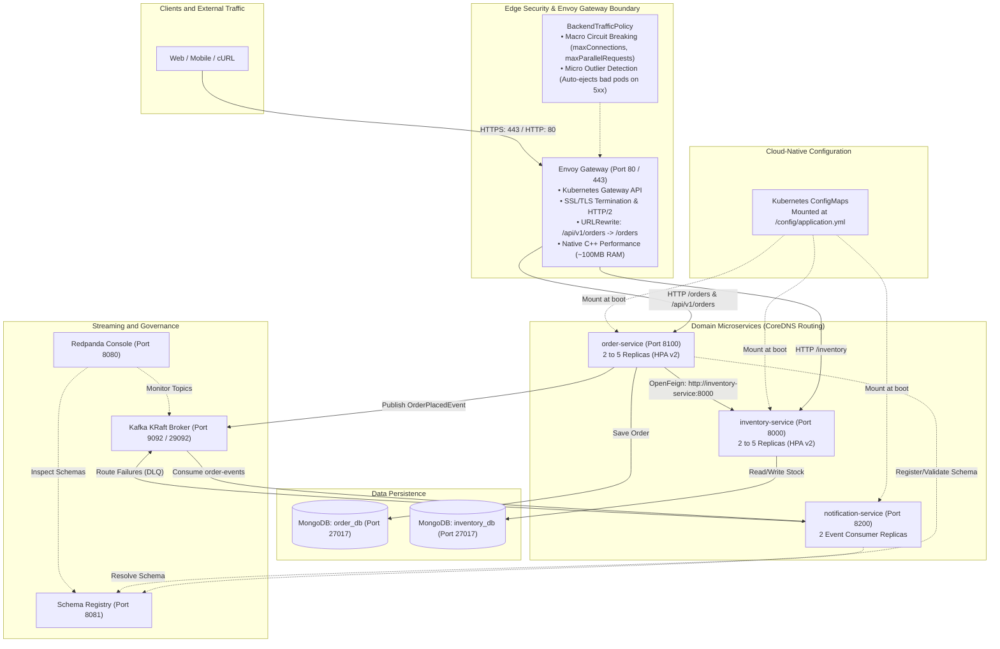
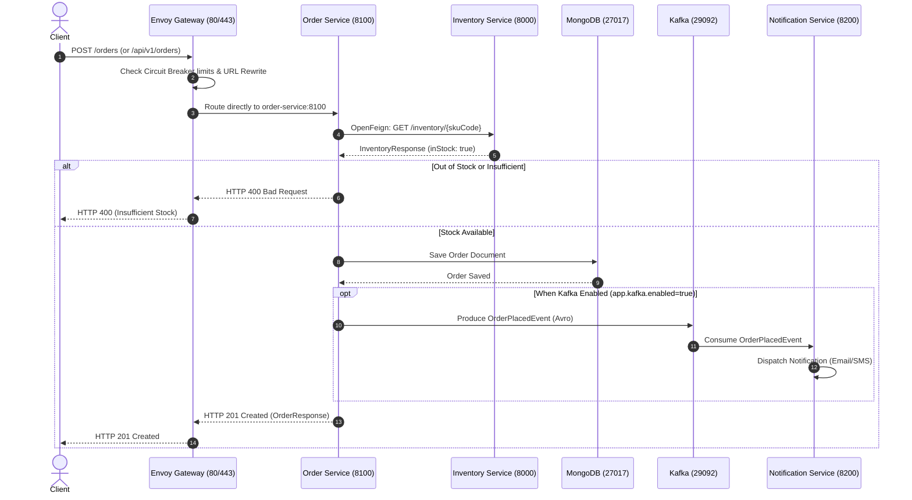

# Distributed Event-Driven Cloud-Native Microservices Architecture

> Enterprise-grade, resilient e-commerce microservices mesh built with Spring Boot, OpenFeign, Apache Kafka (KRaft), Confluent Schema Registry, MongoDB, and Modern Kubernetes (**CNCF Gateway API, Envoy Gateway v1.9+, Native Circuit Breaking & Outlier Detection, TLS, HPA v2**).

---

## 1. System Architecture



---

## 2. End-to-End Order Checkout Sequence



---

## 3. Services & Port Allocations Matrix

| Service / Infrastructure | Port | Protocol | Data Store / Dependency | Role & Responsibilities | Details |
|---|---|---|---|---|---|
| **Envoy Gateway** | `80` / `443` | HTTP / HTTP/2 | Cluster Services | Kubernetes Gateway API, TLS termination, circuit breaking, path routing | [charts/gateway](charts/microservices/templates/gateway/) |
| **Inventory Service** | `8000` | HTTP | MongoDB (`inventory_db`) | Stock level checks, catalog management, resilience sandbox | [inventory-service](inventory-service/README.md) |
| **Order Service** | `8100` | HTTP | MongoDB (`order_db`), Kafka (`29092`) | Checkout orchestration, Feign client, dynamic Avro producer | [order-service](order-service/README.md) |
| **Notification Service** | `8200` | HTTP / Kafka | Kafka (`29092`), Schema Registry (`8081`) | Asynchronous consumer, hybrid DLQ recovery publisher | [notification-service](notification-service/README.md) |
| **Schema Registry** | `8081` | HTTP | Kafka cluster | Confluent Schema Registry for binary Avro contracts | [charts/infrastructure](charts/microservices/templates/infrastructure/schema-registry.yaml) |
| **Redpanda Console** | `8080` | HTTP | Kafka (`29092`), Schema Registry (`8081`) | Real-time Web UI for topics, consumer lags, and DLQ inspection | [docker-compose.yml](docker-compose.yml) |
| **MongoDB** | `27017` | Mongo Wire | WiredTiger Disk Storage | Document database for orders and catalog stock | [charts/infrastructure](charts/microservices/templates/infrastructure/mongodb.yaml) |
| **Kafka Broker** | `9092` / `29092` | Kafka Binary | KRaft Quorum Storage | Event broker (`order-events`, `order-events.dlq`) | [charts/infrastructure](charts/microservices/templates/infrastructure/kafka.yaml) |

---

## 4. Deployment Models & Workflows

This repository supports three production-aligned deployment models. For detailed runbooks, parameter specifications, and architecture guides, follow the modular documentation below:

| Deployment Model | Primary Tooling | Use Case | Detailed Runbook |
|---|---|---|---|
| **Standalone Local** | Docker Compose | Fast local feature development without Kubernetes | [`docker-compose.yml`](docker-compose.yml) |
| **Enterprise Packaging** | Helm 3/4 | Parameterized releases, multi-environment profiles (`dev`, `prod`), autoscaling | [**Helm Runbook**](charts/microservices/README.md) |
| **Continuous Delivery** | ArgoCD (GitOps) | Automated pull-based sync from GitHub, self-healing, zero-touch deployments | [**GitOps Runbook**](gitops/README.md) |
| **CI/CD Pipeline** | GitHub Actions | Automated Helm linting, Java compile, DockerHub buildx, image tag promotion | [**Workflow File**](.github/workflows/ci-cd.yaml) |

### Quick Deploy Commands

```bash
# 1. Local Helm Deployment (Default Baseline)
helm upgrade --install microservices ./charts/microservices -n microservices --create-namespace

# 2. Deploy with Production Profile (High Availability, 3+ Replicas, Strict Limits)
helm upgrade --install microservices ./charts/microservices -f ./charts/microservices/values-prod.yaml -n microservices

# 3. Enable GitOps Continuous Delivery via ArgoCD
kubectl apply -f gitops/application.yaml
```

---

## 5. Verification & Live Traffic Runbook

### 1. Test Inventory via Envoy Gateway (Port 80 Cleartext HTTP)
```bash
curl -i http://localhost/inventory/IPHONE_16
```

### 2. Test Inventory via Envoy Gateway (Port 443 HTTPS TLS)
```bash
curl -k -i https://localhost/inventory/IPHONE_16
```

### 3. Place Order via Direct Path (`/orders`)
```bash
curl -i -X POST http://localhost/orders \
  -H "Content-Type: application/json" \
  -d '{"skuCode":"IPHONE_16","quantity":1,"price":999.00}'
```

### 4. Place Order via URLRewrite Path (`/api/v1/orders`)
```bash
curl -i -X POST http://localhost/api/v1/orders \
  -H "Content-Type: application/json" \
  -d '{"skuCode":"IPHONE_16","quantity":1,"price":999.00}'
```

### 5. Verify Asynchronous Kafka Notification Delivery
```bash
kubectl logs -l app=notification-service -n microservices --tail=20 | grep -E "NOTIFICATION|EMAIL"
```

### 6. Verify Autoscaling Status (HPA v2)
```bash
kubectl get hpa -n microservices
```

---

## 6. Modular Documentation Index

Each service and infrastructure layer maintains its own dedicated, in-depth documentation:

| Domain / Layer | Folder | Responsibilities & Topics Covered |
|---|---|---|
| **Order Service** | [`order-service/`](order-service/README.md) | Synchronous Feign client, MongoDB persistence, Avro event producer, feature flags. |
| **Inventory Service** | [`inventory-service/`](inventory-service/README.md) | Real-time stock queries, catalog seeding, Resilience4j circuit breaker sandbox. |
| **Notification Service** | [`notification-service/`](notification-service/README.md) | Kafka consumer, Confluent Schema Registry, error handling & dead letter queue (DLQ). |
| **Helm Packaging** | [`charts/microservices/`](charts/microservices/README.md) | Chart architecture, `values.yaml` reference, environment profiles (`dev`, `prod`), rollback guides. |
| **GitOps & ArgoCD** | [`gitops/`](gitops/README.md) | ArgoCD installation, `application.yaml` declaration, self-healing tests, UI access. |
| **CI/CD Automation** | [`.github/workflows/`](.github/workflows/ci-cd.yaml) | GitHub Actions pipeline: Helm lint, Maven compile, DockerHub buildx, GitOps tag bump. |

---

## 7. Directory Structure

```text
microservices/
├── .github/                       # GitHub Actions continuous integration & delivery
│   └── workflows/
│       └── ci-cd.yaml             # Multi-stage automated pipeline with GitOps promotion
├── README.md                      # Master architecture & navigation hub
├── docker-compose.yml             # Standalone local Docker Compose runtime
├── docker/                        # Docker volume configurations
├── inventory-service/             # Port 8000 (MongoDB stock repository)
├── order-service/                 # Port 8100 (OpenFeign, MongoDB, Avro Producer)
├── notification-service/          # Port 8200 (Spring Kafka Consumer, Resilient DLQ)
├── gitops/                        # ArgoCD GitOps continuous delivery declarations
│   └── application.yaml           # Automated sync, self-healing & HPA ignore rules
└── charts/                        # Enterprise Helm 3 packaging (single source of truth)
    └── microservices/             # Parameterized chart with dev/prod profiles
        ├── Chart.yaml             # Chart metadata
        ├── README.md              # Helm reference and commands
        ├── values.yaml            # Local baseline values
        ├── values-dev.yaml        # Development overlay
        ├── values-prod.yaml       # Production overlay
        └── templates/             # Declarative templates (apps, config, gateway, infra, hpa)
```
