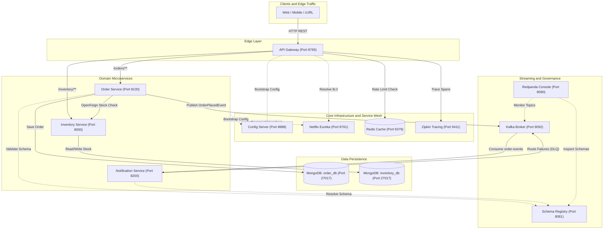
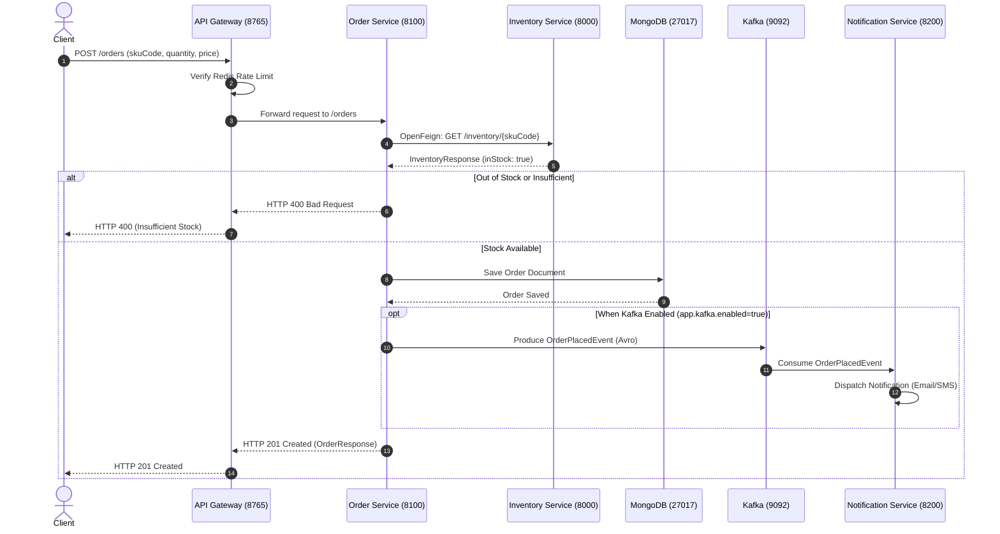

# Distributed Event-Driven Microservices Architecture

> Enterprise-grade, resilient e-commerce microservices mesh built with Spring Boot, Spring Cloud, Netflix Eureka, Redis Reactive Rate Limiting, OpenFeign, Apache Kafka, Confluent Schema Registry, and MongoDB.

---

## 1. System Architecture



---

## 2. End-to-End Order Checkout Sequence



---

## 3. Services & Port Allocations Matrix

| Service / Infrastructure | Port | Protocol | Data Store / Dependency | Role & Responsibilities | Details |
|---|---|---|---|---|---|
| **Config Server** | `8888` | HTTP | Local filesystem (`config-repo/`) | Centralized, profile-driven external configuration provider | [README](config-server/README.md) |
| **Naming Server** | `8761` | HTTP | In-Memory Registry | Netflix Eureka service discovery, client-side load balancing | [README](naming-server/README.md) |
| **API Gateway** | `8765` | HTTP / WebFlux | Redis (`6379`), Eureka (`8761`) | Non-blocking edge router, Redis rate limiter, circuit breakers | [README](api-gateway/README.md) |
| **Inventory Service** | `8000` | HTTP | MongoDB (`inventory_db`) | Stock level checks, catalog management, resilience sandbox | [README](inventory-service/README.md) |
| **Order Service** | `8100` | HTTP | MongoDB (`order_db`), Kafka (`9092`) | Checkout orchestration, Feign client, dynamic Avro producer | [README](order-service/README.md) |
| **Notification Service** | `8200` | HTTP / Kafka | Kafka (`9092`), Schema Registry (`8081`) | Asynchronous consumer, hybrid DLQ recovery publisher | [README](notification-service/README.md) |
| **Schema Registry** | `8081` | HTTP | Kafka cluster | Confluent Schema Registry for binary Avro contracts | - |
| **Redpanda Console** | `8080` | HTTP | Kafka (`29092`), Schema Registry (`8081`) | Real-time Web UI for topics, consumer lags, and DLQ inspection | - |
| **Zipkin** | `9411` | HTTP | In-Memory / Elasticsearch | Distributed trace analysis and latency flame graphs | - |
| **Redis** | `6379` | RESP | In-Memory Cache | Token bucket rate limiting state storage | - |
| **MongoDB** | `27017` | Mongo Wire | WiredTiger Disk Storage | Document database for orders and catalog stock | - |
| **Kafka Broker** | `9092` / `29092` | Kafka Binary | Local Kraft / Zookeeper logs | Event broker (`order-events`, `order-events.dlq`) | - |

---

## 4. Operating Modes

This architecture provides flexible runtime operation depending on infrastructure availability:

### Mode 1: Lightweight REST Mode (Zero Kafka Footprint)
- **Use Case**: Quick local development, REST endpoint verification, and testing when Kafka or Docker is unavailable.
- **Enabled by**: Setting `app.kafka.enabled: false` in `config-repo/order-service.yml`.
- **Services Needed**:
  - `config-server` (:8888)
  - `naming-server` (:8761)
  - `inventory-service` (:8000)
  - `order-service` (:8100)
  - `api-gateway` (:8765)
  - MongoDB (:27017)
- **Result**: Orders are placed, stock is verified via Feign, and persisted to MongoDB without attempting Kafka connections or raising errors.

### Mode 2: Full Event-Driven Mode
- **Use Case**: Production-grade event streaming, real-time customer notifications, schema contract enforcement, and DLQ handling.
- **Enabled by**: Setting `app.kafka.enabled: true` in `config-repo/order-service.yml`.
- **Services Needed**: All services from Mode 1 plus `Kafka` (:9092), `Schema Registry` (:8081), `Notification Service` (:8200), and `Redpanda Console` (:8080).
- **Dynamic Switch**: Toggling between modes requires zero service restarts. Simply update `app.kafka.enabled` and invoke:
  ```bash
  curl -X POST http://localhost:8100/actuator/refresh
  ```

---

## 5. Observability & Management Dashboards

| Tool | URL | Credentials / Notes |
|---|---|---|
| **Netflix Eureka Dashboard** | [http://localhost:8761](http://localhost:8761) | Live instance registry and heartbeat monitoring |
| **Redpanda Console** | [http://localhost:8080](http://localhost:8080) | Topic partitions, consumer offsets, Avro schemas, and DLQ messages |
| **Zipkin Distributed Tracing** | [http://localhost:9411](http://localhost:9411) | End-to-end request latencies and trace waterfall views |
| **Confluent Schema Registry** | [http://localhost:8081/subjects](http://localhost:8081/subjects) | Registered Avro contract schemas and versions |

---

## 6. Quickstart & Verification Commands

### 1. Verify Service Discovery
```bash
curl -s http://localhost:8761/eureka/apps | grep -E "app>|instanceId"
```

### 2. Verify Inventory via API Gateway
```bash
curl -s http://localhost:8765/inventory/IPHONE_16
```

### 3. Place Order via API Gateway
```bash
curl -i -X POST http://localhost:8765/orders \
  -H "Content-Type: application/json" \
  -d '{"skuCode":"IPHONE_16","quantity":1,"price":999.00}'
```

### 4. Test Gateway Rate Limiting (Redis Token Bucket)
```bash
# Execute rapid requests to trigger HTTP 429
for i in {1..8}; do curl -s -o /dev/null -w "%{http_code}\n" http://localhost:8765/inventory/IPHONE_16; done
```

### 5. Dynamic Hot-Reload of Feature Flags
```bash
# Rebind properties dynamically without restarting the JVM:
curl -X POST http://localhost:8100/actuator/refresh
```

---

## 7. Directory Structure

```
microservices/
├── README.md                      # Root architecture documentation
├── redpanda-console.yaml          # Redpanda Console Kafka & Schema Registry config
├── config-repo/                   # Centralized configuration properties
│   ├── api-gateway.yml
│   ├── inventory-service.yml
│   ├── order-service.yml
│   └── notification-service.yml
├── config-server/                 # Port 8888 (Spring Cloud Config)
│   └── README.md
├── naming-server/                 # Port 8761 (Netflix Eureka Registry)
│   └── README.md
├── api-gateway/                   # Port 8765 (Spring Cloud Gateway + Redis Rate Limiter)
│   └── README.md
├── inventory-service/             # Port 8000 (MongoDB stock repository)
│   └── README.md
├── order-service/                 # Port 8100 (OpenFeign, MongoDB, Avro Producer)
│   └── README.md
└── notification-service/          # Port 8200 (Spring Kafka Consumer, Resilient DLQ)
    └── README.md
```
