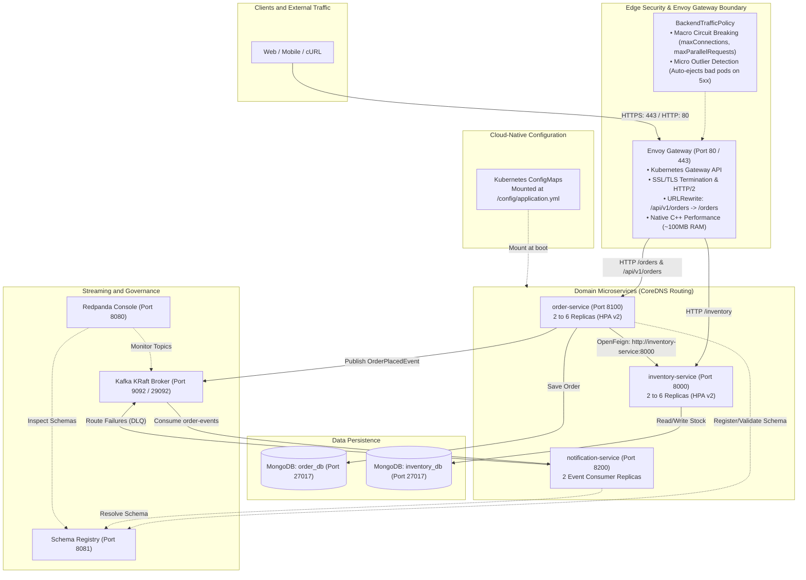
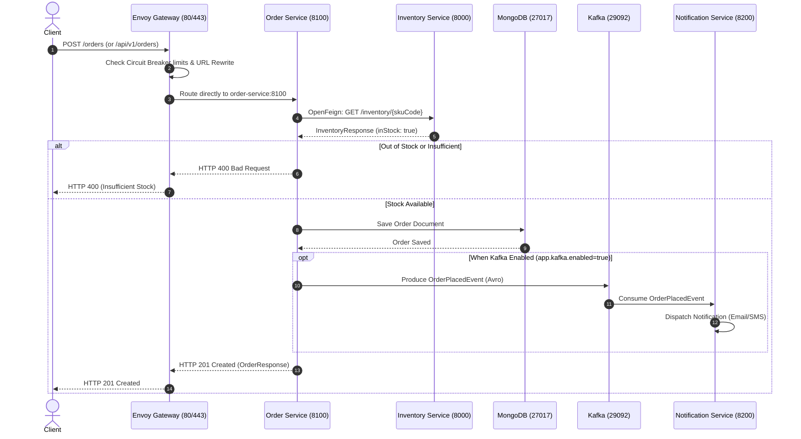

# Distributed Event-Driven Cloud-Native Microservices Architecture

> Enterprise-grade, resilient e-commerce microservices mesh built with Spring Boot, OpenFeign, Apache Kafka (KRaft), Confluent Schema Registry, MongoDB, and Modern Kubernetes (**CNCF Gateway API, Envoy Gateway v1.9+, Native Circuit Breaking & Outlier Detection, TLS, HPA v2**).

---

## 1. System Architecture



---

## 2. End-to-End Order Checkout Sequence



---

## 3. Services & Port Allocations Matrix

| Service / Infrastructure | Port | Protocol | Data Store / Dependency | Role & Responsibilities | Details |
|---|---|---|---|---|---|
| **Envoy Gateway** | `80` / `443` | HTTP / HTTP/2 | Cluster Services | Kubernetes Gateway API, TLS termination, circuit breaking, path routing | [charts/gateway](charts/microservices/templates/gateway/) |
| **Inventory Service** | `8000` | HTTP | MongoDB (`inventory_db`) | Stock level checks, catalog management, resilience sandbox | [inventory-service](inventory-service/) |
| **Order Service** | `8100` | HTTP | MongoDB (`order_db`), Kafka (`29092`) | Checkout orchestration, Feign client, dynamic Avro producer | [order-service](order-service/) |
| **Notification Service** | `8200` | HTTP / Kafka | Kafka (`29092`), Schema Registry (`8081`) | Asynchronous consumer, hybrid DLQ recovery publisher | [notification-service](notification-service/) |
| **Schema Registry** | `8081` | HTTP | Kafka cluster | Confluent Schema Registry for binary Avro contracts | [charts/infrastructure](charts/microservices/templates/infrastructure/schema-registry.yaml) |
| **Redpanda Console** | `8080` | HTTP | Kafka (`29092`), Schema Registry (`8081`) | Real-time Web UI for topics, consumer lags, and DLQ inspection | [docker-compose.yml](docker-compose.yml) |
| **MongoDB** | `27017` | Mongo Wire | WiredTiger Disk Storage | Document database for orders and catalog stock | [charts/infrastructure](charts/microservices/templates/infrastructure/mongodb.yaml) |
| **Kafka Broker** | `9092` / `29092` | Kafka Binary | KRaft Quorum Storage | Event broker (`order-events`, `order-events.dlq`) | [charts/infrastructure](charts/microservices/templates/infrastructure/kafka.yaml) |

---

## 4. Kubernetes Helm Packaging & Deployment

All deployments are managed natively via the Helm chart in [`charts/microservices/`](charts/microservices/):

* **[Helm Chart Documentation](charts/microservices/README.md)**: Full parameter reference, environment profiles, and life-cycle management.
* **[values.yaml](charts/microservices/values.yaml)**: Baseline local environment configuration.
* **[values-dev.yaml](charts/microservices/values-dev.yaml)**: Development profile (single replica, low resources, autoscaling disabled).
* **[values-prod.yaml](charts/microservices/values-prod.yaml)**: Production profile (high availability 3+ replicas, strict CPU/memory limits, external managed DB hooks).

### Deploy with Helm
```bash
# 1. Install or upgrade local cluster
helm upgrade --install microservices ./charts/microservices -n microservices --create-namespace

# 2. Deploy with Dev profile
helm upgrade --install microservices ./charts/microservices -f ./charts/microservices/values-dev.yaml -n microservices

# 3. Deploy with Prod profile (e.g. Azure AKS / Cloud)
helm upgrade --install microservices ./charts/microservices -f ./charts/microservices/values-prod.yaml -n microservices
```

---

## 5. Quickstart & Verification Commands

### 1. Test Inventory via Envoy Gateway (Port 80 HTTP)
```bash
curl -i http://localhost/inventory/IPHONE_16
```

### 2. Test Inventory via Envoy Gateway (Port 443 HTTPS TLS)
```bash
curl -k -i https://localhost/inventory/IPHONE_16
```

### 3. Place Order via Direct Path (`/orders`)
```bash
curl -i -X POST http://localhost/orders \
  -H "Content-Type: application/json" \
  -d '{"orderNumber":"ORD-001","skuCode":"IPHONE_16","price":999.99,"quantity":1}'
```

### 4. Place Order via URLRewrite Path (`/api/v1/orders`)
```bash
curl -i -X POST http://localhost/api/v1/orders \
  -H "Content-Type: application/json" \
  -d '{"orderNumber":"ORD-002","skuCode":"IPHONE_16","price":999.99,"quantity":1}'
```

### 5. Verify Asynchronous Kafka Notification Delivery
```bash
kubectl logs -l app=notification-service -n microservices --tail=20 | grep -E "NOTIFICATION|EMAIL"
```

### 6. Verify Autoscaling Status
```bash
kubectl get hpa -n microservices
```

---

## 6. Directory Structure

```text
microservices/
├── README.md                      # Master architecture & overview documentation
├── docker-compose.yml             # Standalone local Docker Compose runtime
├── docker/                        # Docker volume configurations
├── inventory-service/             # Port 8000 (MongoDB stock repository)
├── order-service/                 # Port 8100 (OpenFeign, MongoDB, Avro Producer)
├── notification-service/          # Port 8200 (Spring Kafka Consumer, Resilient DLQ)
└── charts/                        # Enterprise Helm 3 packaging (single source of truth)
    └── microservices/             # Parameterized chart with dev/prod profiles
        ├── Chart.yaml             # Chart metadata
        ├── README.md              # Helm reference and commands
        ├── values.yaml            # Local baseline values
        ├── values-dev.yaml        # Development overlay
        ├── values-prod.yaml       # Production overlay
        └── templates/             # Declarative templates (apps, config, gateway, infra, hpa)
```
