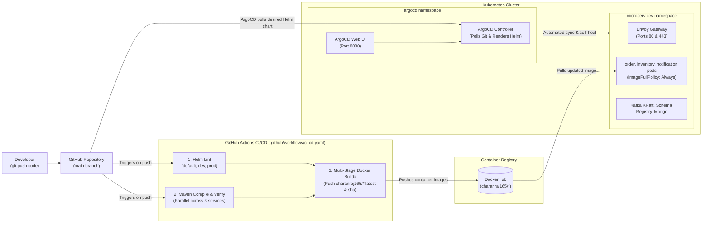

# GitOps Continuous Delivery with ArgoCD

This directory contains declarative GitOps definitions for continuous delivery and automated cluster state reconciliation using **ArgoCD**.

---

## 1. Architecture Overview

In our GitOps workflow, Git is the single source of truth for all Kubernetes resources. The continuous delivery cycle pairs **GitHub Actions** (CI) with **ArgoCD** (CD):



### Clean Architecture Principles (Option A)
1. **Zero Bot Commits**: GitHub Actions never writes back to Git. Your Git history remains 100% clean and human-authored, completely eliminating any possibility of recursive workflow loops.
2. **Path Filtering**: The workflow only triggers on application directories (`order-service/**`, `inventory-service/**`, `notification-service/**`, `charts/**`), ignoring markdown and documentation updates.
3. **Lean Build Execution**: No heavy external cache stores (`type=gha`); multi-stage Docker builds execute natively in seconds with standard Maven local caching.

---

## 2. Installation Guide

### Step 1: Install ArgoCD into the Cluster
Create the dedicated `argocd` namespace and install ArgoCD using Kubernetes Server-Side Apply:

```bash
# 1. Create namespace
kubectl create namespace argocd --dry-run=client -o yaml | kubectl apply -f -

# 2. Install ArgoCD with Server-Side Apply
kubectl apply --server-side --force-conflicts -n argocd \
  -f https://raw.githubusercontent.com/argoproj/argo-cd/stable/manifests/install.yaml

# 3. Wait for ArgoCD pods to become ready
kubectl wait --for=condition=Available deployment/argocd-server -n argocd --timeout=120s
```

### Step 2: Retrieve the Initial Admin Password
ArgoCD generates a random initial password stored in a Kubernetes Secret:

```bash
kubectl -n argocd get secret argocd-initial-admin-secret \
  -o jsonpath="{.data.password}" | base64 -d && echo
```

### Step 3: Access the ArgoCD Web Dashboard
Port-forward the ArgoCD web UI to your local machine:

```bash
kubectl port-forward svc/argocd-server -n argocd 8080:443
```
* **URL**: [https://localhost:8080](https://localhost:8080) *(proceed past browser self-signed SSL warning)*
* **Username**: `admin`
* **Password**: *(Password retrieved in Step 2)*

---

## 3. GitOps Application Specification

The complete declaration is in [`application.yaml`](application.yaml). Key configuration highlights:

- **Automated Sync & Self-Healing**: Automatically prunes removed resources and restores cluster state against manual `kubectl` tampering.
- **HPA Conflict Resolution**: Ignores replica drift so Horizontal Pod Autoscaling can scale dynamically without triggering out-of-sync loops.

```yaml
# Key policy snippet from gitops/application.yaml
syncPolicy:
  automated:
    prune: true     # Removes cluster resources if deleted from Git
    selfHeal: true  # Reverts manual 'kubectl edit' tampering back to Git state
ignoreDifferences:
  - group: apps
    kind: Deployment
    jsonPointers:
      - /spec/replicas # Allows HPA to scale replicas without fighting Git
```

### Apply Application
```bash
kubectl apply -f gitops/application.yaml
```

---

## 4. Verification & Testing Runbook

### Verification 1: Check Application Sync Status
Check the status of the ArgoCD Application via CLI:

```bash
kubectl get application -n argocd
```

**Expected Output:**
```text
NAME            SYNC STATUS   HEALTH STATUS
microservices   Synced        Progressing / Healthy
```

View the individual sync status of all 22 managed components:
```bash
kubectl get application microservices -n argocd \
  -o jsonpath='{range .status.resources[*]}{.kind}{"/"}{.name}{" -> "}{.status}{"\n"}{end}'
```

---

### Verification 2: Test Automated Self-Healing (Simulate Outage)
GitOps guarantees cluster self-healing against unauthorized manual changes or accidental deletions.

1. **Delete a Deployment manually**:
   ```bash
   kubectl delete deployment inventory-service -n microservices
   ```
2. **Watch ArgoCD immediately recreate it**:
   ```bash
   kubectl get deployment inventory-service -n microservices
   ```
   *Within 2–3 seconds, ArgoCD detects the discrepancy between Git and the cluster and restores `inventory-service`.*

---

### Verification 3: Continuous Delivery (Change via Git)
To roll out a configuration or image update:

1. Edit a value in [`charts/microservices/values.yaml`](../charts/microservices/values.yaml) (e.g. adjust `minStockThreshold` or `replicaCount`).
2. Commit and push:
   ```bash
   git commit -am "chore: adjust inventory stock threshold"
   git push origin main
   ```
3. ArgoCD polls GitHub, renders the new Helm template, and updates the cluster with zero manual `kubectl` intervention.

---

### Verification 4: Instant Emergency Rollback
To roll back a bad deployment, revert the commit in Git:

```bash
git revert HEAD
git push origin main
```
ArgoCD detects the reverted commit and restores the previous working state automatically.

---

## 5. Related Documentation

- [**Root Architecture & Overview**](../README.md)
- [**Helm Chart Runbook**](../charts/microservices/README.md)
- [**Order Service**](../order-service/README.md)
- [**Inventory Service**](../inventory-service/README.md)
- [**Notification Service**](../notification-service/README.md)

