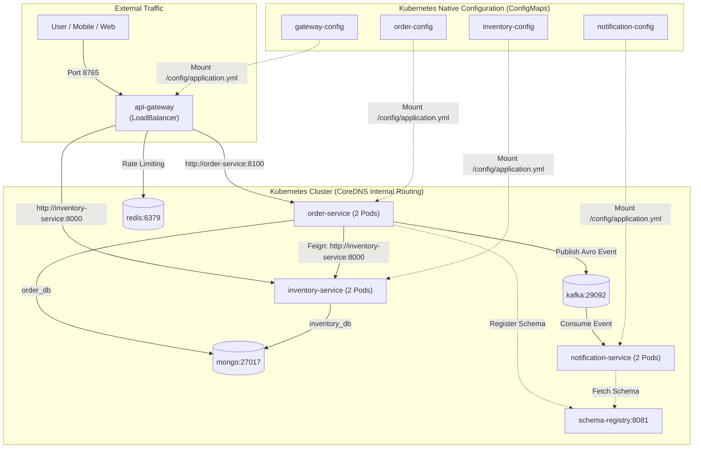

# Cloud-Native Enterprise Kubernetes Architecture

Production Kubernetes manifests for the event-driven microservices mesh, designed specifically for Microsoft Azure (AKS) and multi-node local development with Docker Desktop (`kind`).

---

## Architecture Diagram



---

## Directory Structure

```text
k8s/
├── README.md                          # Master runbook & architecture reference
├── 00-namespace/
│   └── namespace.yaml                 # Dedicated 'microservices' namespace
├── 01-config/
│   ├── inventory-config.yaml          # ConfigMap: MongoDB, Resilience4j, Min-stock threshold
│   ├── order-config.yaml              # ConfigMap: MongoDB, Kafka Avro Producer, Feign Direct URL
│   ├── notification-config.yaml       # ConfigMap: Kafka Avro Consumer, Deserializers, Group ID, DLQ
│   └── gateway-config.yaml            # ConfigMap: Routes, Redis Rate Limiter, Circuit Breakers & Fallbacks
├── 02-infrastructure/
│   ├── mongo.yaml                     # MongoDB Deployment & Service (27017)
│   ├── redis.yaml                     # Redis Cache Deployment & Service (6379)
│   ├── kafka.yaml                     # Kafka KRaft Broker Deployment & Service (9092, 29092)
│   └── schema-registry.yaml           # Confluent Schema Registry Deployment & Service (8081)
└── 03-apps/
    ├── inventory-service.yaml         # 2 Replicas, RollingUpdate, Actuator Probes & Service (8000)
    ├── order-service.yaml             # 2 Replicas, RollingUpdate, Actuator Probes & Service (8100)
    ├── notification-service.yaml      # 2 Replicas, RollingUpdate, Actuator Probes & Service (8200)
    └── api-gateway.yaml               # 2 Replicas, LoadBalancer Service (8765)
```

---

## Architectural Principles & Evolution

| Layer | In Docker Compose | In Kubernetes (Enterprise) | Architectural Benefit |
| :--- | :--- | :--- | :--- |
| **Configuration** | HTTP process (`config-server`) fetching Git | Native Kubernetes `ConfigMaps` mounted into `/config/application.yml` | **Zero network latency & zero startup race conditions.** Configurations are mounted as local files before the container boots. |
| **Service Discovery** | Netflix Eureka (`naming-server:8761`) with 30s polling | Kubernetes `CoreDNS` (`http://inventory-service:8000`) | Built-in cluster DNS. `kube-proxy` load-balances at the Linux kernel level with zero stale cache delays. |
| **Inter-Service Calls (Feign)** | `@FeignClient` resolved dynamic IPs via Eureka | Direct Service URL: `http://inventory-service:8000` | Native cluster routing; transparently load-balanced across healthy replicas. |
| **Gateway Routing** | `uri: lb://order-service` | `uri: http://order-service:8100` | Directly leverages Kubernetes virtual IPs (`ClusterIP`). |
| **Edge Access** | Host port mapping (`ports: 8765:8765`) | Kubernetes `type: LoadBalancer` | Automatically provisions a cloud Public IP on Azure Load Balancer. |
| **High Availability** | Single container per service | 2 replicas with `RollingUpdate` (`maxSurge: 1`, `maxUnavailable: 0`) | Zero-downtime rolling upgrades and automatic node failover. |
| **Self-Healing** | Simple `restart: always` | Native Actuator probes (`/actuator/health/liveness` & `readiness`) | Kubelet auto-reboots deadlocked JVMs and isolates unready pods during warmup. |

---

## Cluster Setup: Local vs. Cloud

### A. Local Setup (Docker Desktop with `kind`)
1. In Docker Desktop, navigate to **Settings** $\rightarrow$ **Kubernetes**.
2. Check **Enable Kubernetes**.
3. Set **Cluster type**: `kind`.
4. Set **Node(s)**: `2` (simulates multi-node scheduling).
5. Click **Apply & restart** and wait for the bottom-left icon to turn solid green.
6. Verify connection:
   ```bash
   kubectl get nodes
   ```

### B. Cloud Setup (Azure AKS via Pluralsight Sandbox)

#### 1. Authenticate & Configure Target Resource Group
```bash
# Authenticate to Azure CLI
az login

# Set your target environment variables
export RG="<YOUR_RESOURCE_GROUP>"
export LOCATION="<YOUR_LOCATION>"
export CLUSTER_NAME="<YOUR_CLUSTER_NAME>"

# Confirm active subscription & resource group availability
az account show --output table
az group show --name $RG --output table
```

#### 2. Provision Multi-Node AKS Cluster
```bash
az aks create \
  --resource-group $RG \
  --name $CLUSTER_NAME \
  --location $LOCATION \
  --node-count 2 \
  --node-vm-size Standard_B2s \
  --enable-managed-identity \
  --generate-ssh-keys
```
*(Takes approximately 4–6 minutes to complete in Azure. Tip: pass `--no-ssh-key` if you do not want an SSH key generated on your host).*

#### 3. Connect kubectl to Azure AKS
```bash
# Download Azure cluster credentials and merge into ~/.kube/config
az aks get-credentials --resource-group $RG --name $CLUSTER_NAME --overwrite-existing

# Verify connected cloud nodes
kubectl get nodes -o wide
```

#### 4. Switching Contexts Between Local & Cloud
```bash
# View all available cluster contexts
kubectl config get-contexts

# Switch back to local Docker Desktop kind cluster:
kubectl config use-context kind-kind

# Switch to Azure AKS cluster:
kubectl config use-context microservices-aks
```

---

## Deployment Sequence

### 1. Build & Push Multi-Architecture Images
Publish universal `linux/amd64` and `linux/arm64` container images to the registry:
```bash
docker compose build --push api-gateway inventory-service order-service notification-service
```

### 2. Deploy to Kubernetes
Deploy all layers (Namespace, ConfigMaps, Infrastructure, and Microservices) in one command:
```bash
kubectl apply -R -f k8s/
```
*(Or apply individually in order: `00-namespace/` $\rightarrow$ `01-config/` $\rightarrow$ `02-infrastructure/` $\rightarrow$ `03-apps/`).*

Monitor rollout until all 12 workloads report `1/1 Running`:
```bash
kubectl get pods -n microservices -w
```

---

## Verification Procedures

### 1. Target Gateway URL

* **Local (`kind` / Docker Desktop):**
  ```bash
  export GATEWAY_URL="http://localhost:8765"
  ```
* **Cloud (`Azure AKS`):**
  ```bash
  export GATEWAY_IP=$(kubectl get svc api-gateway -n microservices -o jsonpath='{.status.loadBalancer.ingress[0].ip}')
  export GATEWAY_URL="http://${GATEWAY_IP}:8765"
  echo "Gateway URL: ${GATEWAY_URL}"
  ```

---

### 2. Live Verification

#### A. Query Inventory Stock
Hit via cURL or open directly in your web browser:
```bash
curl -i "${GATEWAY_URL}/inventory/IPHONE_16"
```
* **Browser URL:** `${GATEWAY_URL}/inventory/IPHONE_16`
* **Cluster Health URL:** `${GATEWAY_URL}/actuator/health`

#### B. Place an Order (Mongo Persistence + Kafka Avro Event)
```bash
curl -i -X POST "${GATEWAY_URL}/api/v1/orders" \
  -H "Content-Type: application/json" \
  -d '{
    "orderNumber": "ORD-K8S-001",
    "skuCode": "IPHONE_16",
    "price": 999.99,
    "quantity": 1
  }'
```

#### C. Verify Asynchronous Notification Log
```bash
kubectl logs -l app=notification-service -n microservices | grep -E "NOTIFICATION|EMAIL"
```
*Expected log:*
```text
[NOTIFICATION DISPATCHED] Order #... confirmed! SKU: 'IPHONE_16', Quantity: 1, Total: $999.99, Partition: 1, Offset: ...
[EMAIL/SMS SENT] Customer confirmation sent successfully
```

---

## Accessing Internal ClusterIP Services Locally (Debugging)

Because databases and domain services are private `type: ClusterIP`, use `kubectl port-forward` when direct local debugging is needed:

```bash
# Direct access to MongoDB (Compass):
kubectl port-forward svc/mongo 27017:27017 -n microservices &

# Direct access to Redis (redis-cli):
kubectl port-forward svc/redis 6379:6379 -n microservices &

# Direct access to Inventory Service:
kubectl port-forward svc/inventory-service 8000:8000 -n microservices &
```

---

## Teardown & Cleanup

### 1. Delete Kubernetes Workloads
```bash
kubectl delete namespace microservices
```

### 2. Delete Azure AKS Cluster
```bash
az aks delete --resource-group $RG --name $CLUSTER_NAME --yes --no-wait
```

### 3. Remove Temporary SSH Keys (Optional)
```bash
rm -f ~/.ssh/id_rsa ~/.ssh/id_rsa.pub
```
