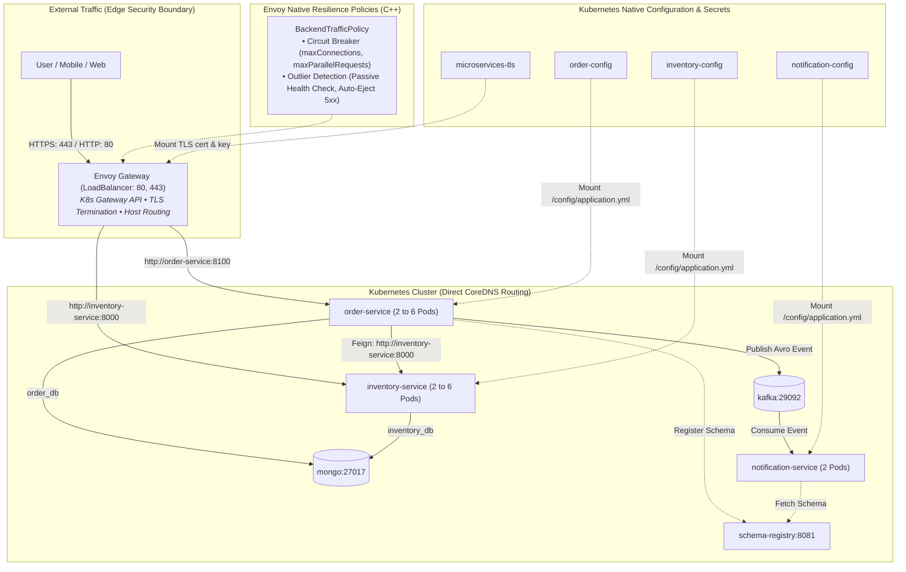

# Cloud-Native Enterprise Kubernetes Architecture: Gateway API & Envoy Gateway

Production Kubernetes manifests for the event-driven microservices mesh, built on the CNCF **Kubernetes Gateway API** and **Envoy Gateway (v1.9+)**, designed for Microsoft Azure (AKS) and multi-node local development with Docker Desktop (`kind`).

---

## Architecture Diagram



---

## Directory Structure

```text
k8s/
├── README.md                          # Master runbook & architecture reference
├── 00-namespace/
│   └── namespace.yaml                 # Dedicated 'microservices' namespace
├── 01-config/
│   ├── inventory-config.yaml          # ConfigMap: MongoDB, Resilience4j, Min-stock threshold
│   ├── order-config.yaml              # ConfigMap: MongoDB, Kafka Avro Producer, Feign Direct URL
│   └── notification-config.yaml       # ConfigMap: Kafka Avro Consumer, Deserializers, Group ID, DLQ
├── 02-infrastructure/
│   ├── mongo.yaml                     # MongoDB Deployment & Service (27017)
│   ├── kafka.yaml                     # Kafka KRaft Broker Deployment & Service (9092, 29092)
│   └── schema-registry.yaml           # Confluent Schema Registry Deployment & Service (8081)
├── 03-apps/
│   ├── inventory-service.yaml         # 2 Replicas, RollingUpdate, Actuator Probes & Service (8000)
│   ├── order-service.yaml             # 2 Replicas, RollingUpdate, Actuator Probes & Service (8100)
│   └── notification-service.yaml      # 2 Replicas, RollingUpdate, Actuator Probes & Service (8200)
├── 04-gateway/
│   ├── gateway-class.yaml             # GatewayClass 'eg' managed by Envoy Gateway controller
│   ├── gateway.yaml                   # Gateway resource (Port 80 HTTP & Port 443 HTTPS TLS)
│   ├── http-routes.yaml               # HTTPRoute: Direct /inventory, /orders, and /api/v1/orders (Rewrite)
│   ├── backend-traffic-policy.yaml    # Envoy Circuit Breaking & Outlier Detection (Auto-ejection)
│   └── tls-secret.yaml.example        # Template for TLS Secret (actual tls-secret.yaml is .gitignored)
└── 05-autoscaling/
    └── hpa.yaml                       # HorizontalPodAutoscalers (HPA v2) for Domain Apps (2 to 6 Pods)
```

---

## Architectural Principles & Evolution

| Layer | Traditional Spring Cloud | Modern Kubernetes Standard (This Architecture) | Architectural Benefit |
| :--- | :--- | :--- | :--- |
| **Edge Gateway** | Custom Java Spring Cloud Gateway (`api-gateway`) + Redis | **Envoy Gateway (K8s Gateway API)** | **Saves ~1.2GB RAM**. Zero JVM startup overhead, native C++ performance, zero garbage collection latency. |
| **Circuit Breaking** | Java Resilience4j in Gateway | Native Envoy `BackendTrafficPolicy` | Macro connection limits + Outlier Detection (automatically ejects failing pods for 30s). |
| **Path Rewriting** | Spring WebFlux `RewritePath` | Gateway API `URLRewrite` filter | Standardized declarative Kubernetes API (`ReplacePrefixMatch`). |
| **Edge Security & TLS** | Custom certificate keystores | Native Gateway TLS termination (`port: 443`) | Unified entrypoint. Automated HTTPS termination with HTTP/2 support. |
| **Service Discovery** | Netflix Eureka with 30s polling | Kubernetes **CoreDNS** (`http://...`) | In-kernel Linux load balancing (`kube-proxy`) with zero stale cache delays. |
| **Configuration** | HTTP `config-server` fetching Git | Native **ConfigMaps** mounted to `/config/application.yml` | Zero network latency & zero startup race conditions. |
| **High Availability** | Single container per service | 2 replicas with `RollingUpdate` | Zero-downtime rolling upgrades and automatic node failover. |
| **Elastic Autoscaling** | Manual container scaling | Native **HPA v2** with Metrics Server | Auto-scales workloads dynamically between 2 and 6 pods based on real-time CPU/Memory. |

---

## Deployment Sequence

### 1. Install Envoy Gateway (One-time cluster setup)
```bash
# Install Gateway API CRDs & Envoy Gateway Controller
kubectl apply --server-side -f https://github.com/envoyproxy/gateway/releases/download/v1.9.3/install.yaml

# Wait until Envoy Gateway controller is available
kubectl wait --timeout=5m -n envoy-gateway-system deployment/envoy-gateway --for=condition=Available
```

### 2. Deploy Microservices Mesh & Gateway Rules
Deploy all layers in one command:
```bash
kubectl apply -R -f k8s/
```
*(Or apply individually: `00-namespace/` $\rightarrow$ `01-config/` $\rightarrow$ `02-infrastructure/` $\rightarrow$ `03-apps/` $\rightarrow$ `04-gateway/` $\rightarrow$ `05-autoscaling/`).*

Monitor rollout:
```bash
kubectl get pods -n microservices -w
```

---

## Verification Procedures

### 1. Verify Gateway Status
```bash
kubectl get gateway -n microservices
kubectl get httproutes -n microservices
kubectl get backendtrafficpolicies -n microservices
```

### 2. Live Functional Verification

#### A. Query Inventory Stock via Envoy Gateway
```bash
# HTTP Port 80
curl -i http://localhost/inventory/IPHONE_16

# HTTPS Port 443 (HTTP/2 + TLS Termination)
curl -k -i https://localhost/inventory/IPHONE_16
```

#### B. Place an Order via Direct Path (`/orders`)
```bash
curl -i -X POST http://localhost/orders \
  -H "Content-Type: application/json" \
  -d '{
    "orderNumber": "ORD-LIVE-001",
    "skuCode": "IPHONE_16",
    "price": 999.99,
    "quantity": 1
  }'
```

#### C. Place an Order via URLRewrite Path (`/api/v1/orders`)
```bash
curl -i -X POST http://localhost/api/v1/orders \
  -H "Content-Type: application/json" \
  -d '{
    "orderNumber": "ORD-LIVE-002",
    "skuCode": "IPHONE_16",
    "price": 999.99,
    "quantity": 1
  }'
```

#### D. Verify Asynchronous Kafka Notification Delivery
```bash
kubectl logs -l app=notification-service -n microservices --tail=20 | grep -E "NOTIFICATION|EMAIL"
```
*Expected log:*
```text
[NOTIFICATION DISPATCHED] Order #... confirmed! SKU: 'IPHONE_16', Quantity: 1, Total: $999.99, Partition: 0, Offset: ...
[EMAIL/SMS SENT] Customer confirmation sent successfully
```

#### E. Test Autoscaling Under Surge Load
```bash
./k8s/05-autoscaling/load-test.sh http://localhost/inventory/IPHONE_16 25 30
kubectl get hpa -n microservices
```

---

## Teardown & Cleanup

```bash
kubectl delete namespace microservices
```
